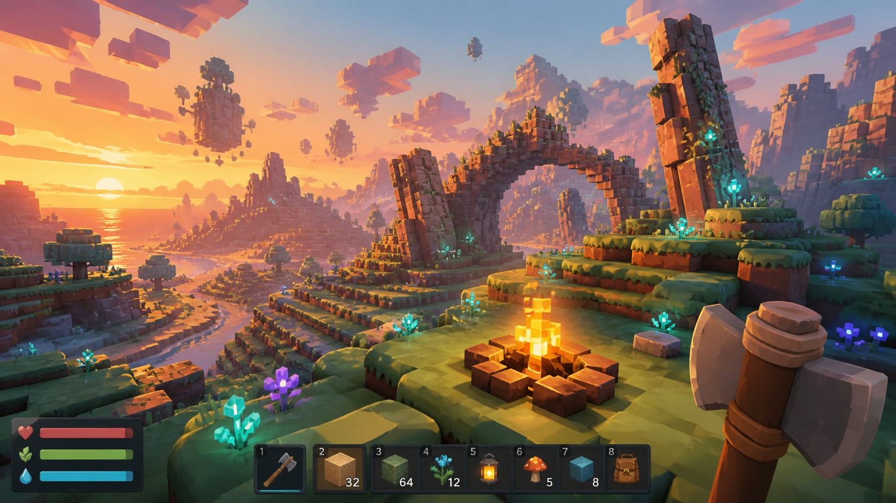
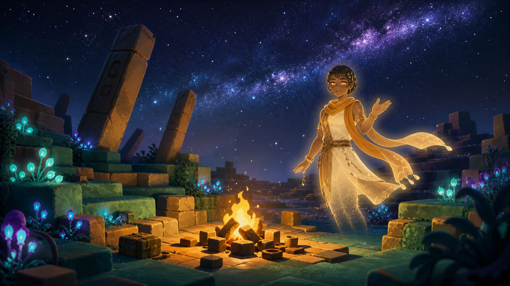
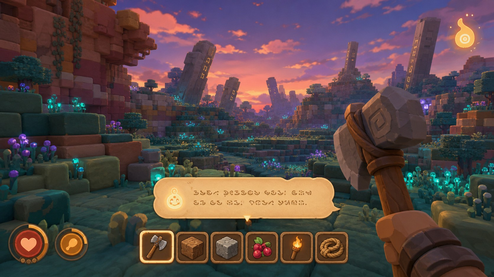
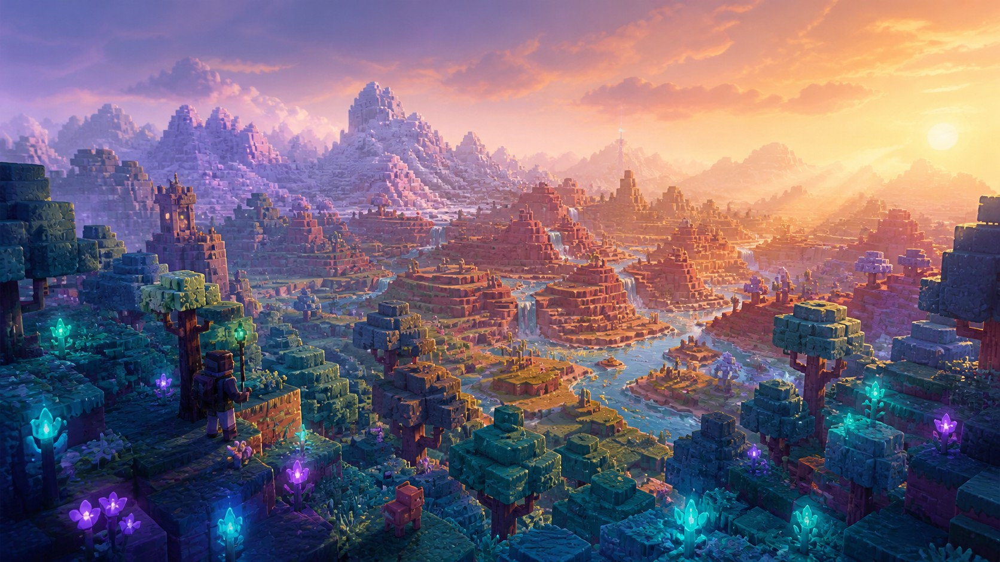
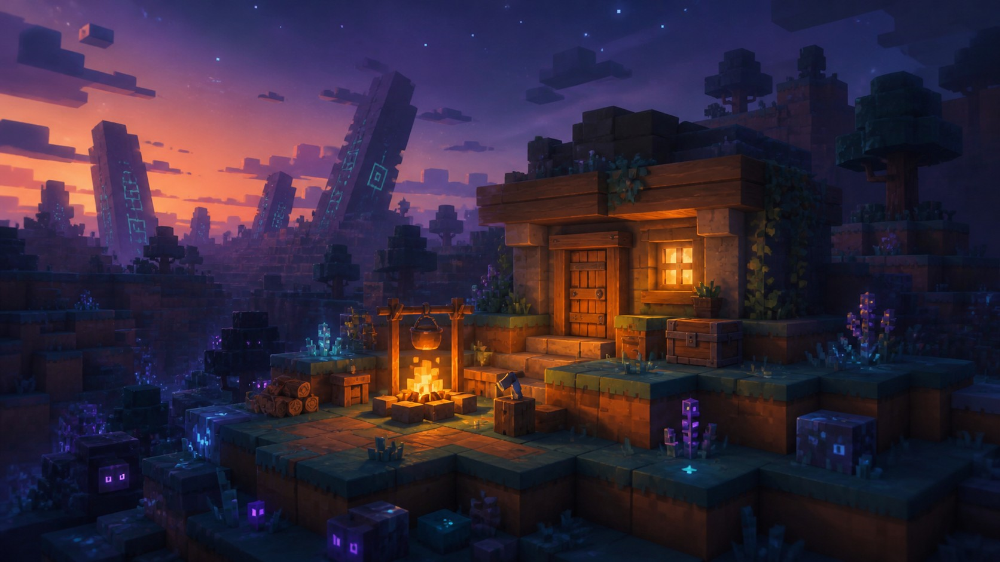
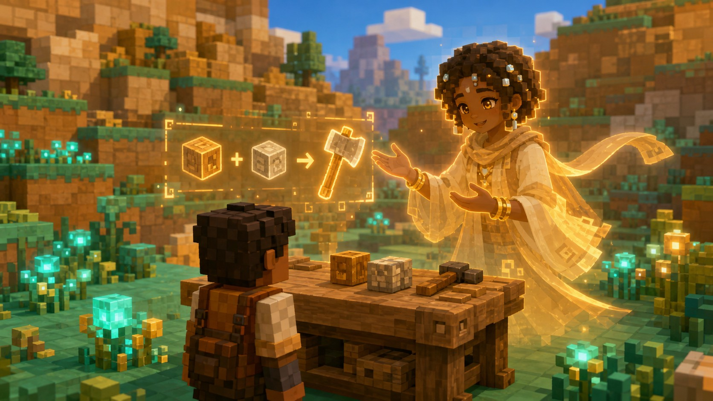
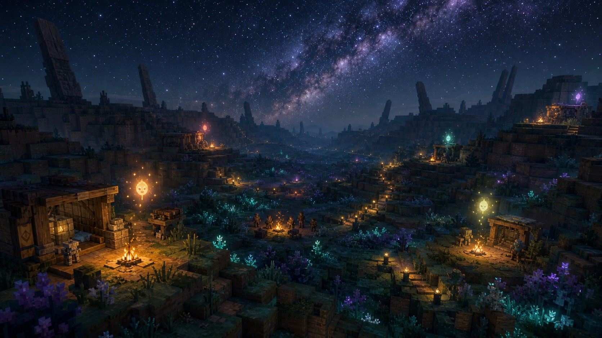
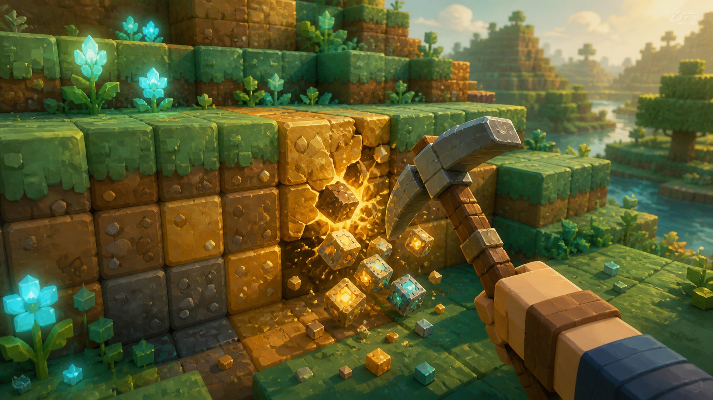

# Project Survival (working title)

A browser-based 3D first-person voxel survival game set in an infinite, procedurally generated world of small breakable blocks and varied biomes, where every player is accompanied by a personal spirit guide — a warm voice that teaches, comments, and can be summoned or dismissed.

Status: concept phase — design bible and concept art first, first playable slice (infinite terrain) to follow.

[Design gamebible](gamebible/gamebible.md)

First-person dusk vista over terraced blocky terrain.

A glowing spirit guide beside a blocky campfire at night.

HUD concept: hotbar, health and hunger dials, ember guide icon, and dialogue bubble.

Multiple biomes meeting in one vista.

First camp: a player-built blocky shelter and campfire at dusk.

The guide teaches crafting through recipe hologlyphs at a workbench.

Multiplayer concept: scattered player camps and ember-motes in a night valley.

First harvest: a block mid-break dropping resources.

Designed by Relic. Made by Ember.
